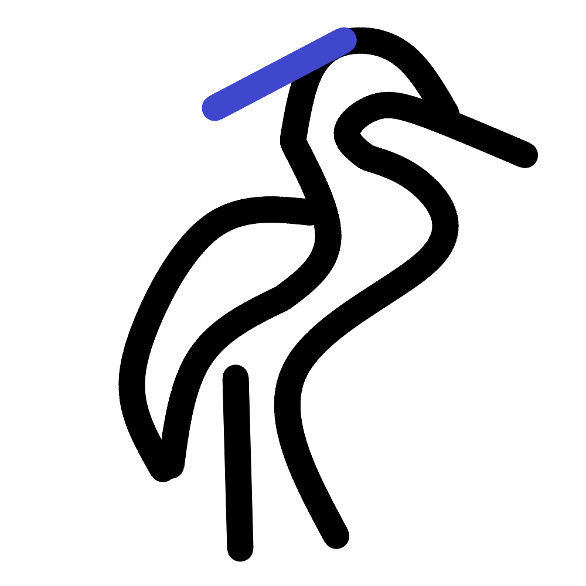

<p align="center">

</p>

<h1 align="center">Heron (Heuristic chess Engine written in Rust)</h1>

Heron is a chess engine, written in Rust.

## Installing Heron
> [!NOTE]
> Heron is a chess engine not a program. It should be used with UCI-compatible GUI (like [Cute Chess](https://github.com/cutechess/cutechess)).

### From Source

1. Install [Rust](https://www.rust-lang.org/tools/install) using `rustup`.
2. Clone the repository:

   ```bash
   git clone https://github.com/ArpaDeveloper/Heron.git
   cd Heron
   ```

3. Build the engine in release mode:

   ```bash
   cargo build --release
   ```

4. The compiled executable will be located in:

   - **Windows:** `target/release/heron.exe`
   - **Linux:** `target/release/heron`
   - **macOS:** `target/release/heron`

### Using with Cute Chess

1. Open Cute Chess.
2. Navigate to **Tools → Settings → Engines**.
3. Add a new engine and select the compiled Heron executable.
4. Select the **UCI** protocol.
5. Save the configuration and start a game or tournament.


### UCI options/Commands
Heron supports the following UCI options:
| Command | Default | Description |
| --- | --- | --- |
| Hash | 16 | Size of the transposition table in MB [1–1024] |

And these commands:
| Command | Description |
| --- | --- |
| `uci` | Identifies the engine |
| `isready` | Confirms the engine is ready |
| `setoption name Hash value <MB>` | Sets the transposition table size in MB [1–1024] |
| `ucinewgame` | Resets the board and clears the transposition table |
| `position` | Sets the board position and optionally applies moves |
| `go` | Searches for the best move |
| `go perft <depth>` | Runs perft divide for move-generation testing |
| `stop` | Stops the current searc. |
| `quit` | Exits the engine |

## Architecture
Heron was designed to be modular and easy to modify, with each file handling a specific part of the engine.

[board.rs](src/board.rs) → Board representation and position management

[evaluation.rs](src/evaluation.rs) → Position evaluation

[fen.rs](src/fen.rs) → FEN parsing and handling

[movegen.rs](src/movegen.rs) → Legal move generation

[main.rs](src/main.rs) → Program entry point

[search.rs](src/search.rs) → Search algorithms

[uci.rs](src/uci.rs) → UCI protocol and command handling

[zobrist.rs](src/zobrist.rs) → Zobrist hashing for position identification
## License

## Acknowledgements
- [Chess Programming Wiki](https://chessprogramming.org/Main_Page)

* Open source chess engines and their communities
